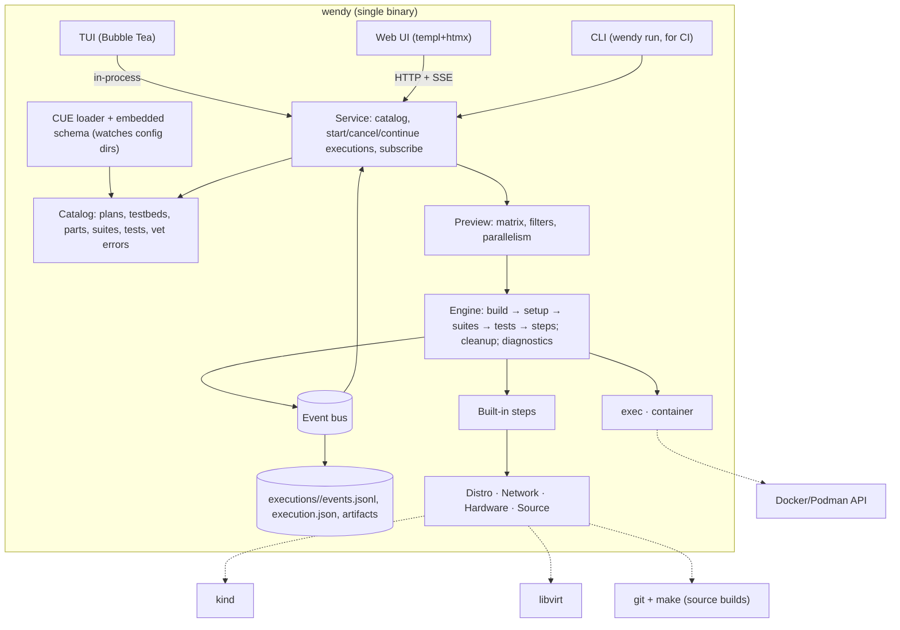

# Wendy — Provisioning Engine for Tinkerbell E2E Runs

**Status:** Draft v2 for review
**Repo / module:** `github.com/tinkerbell/wendy` · **Binary:** `wendy`

---

## 1. Summary

`wendy` is a single Go binary. It builds a Tinkerbell + CAPT testbed from a declarative CUE description and runs composable tests on it. Tinkerbell and CAPT can come from releases or be built from source. Users drive it mainly from a TUI or web UI that load their static config files. Each execution leaves enough diagnostics to debug a failure hours later. v1 runs on a Linux host (a developer machine or a GitHub-hosted CI runner) with kind and libvirt.

It replaces and generalises the CAPT end-to-end scripts it grew out of (§14), called the earlier scripts below:

- **Runner:** a Go runner that shells out to `task`, `cue` and `ginkgo`.
- **Matrix:** 16 hand-written combinations.
- **Suite:** a 7-assertion deploy-and-verify suite.
- **Infrastructure:** kind + libvirt only.

### Decisions

| # | Topic | Decision |
|---|---|---|
| 0 | **Design constraint** | **Write the least code that delivers the feature.** Reuse libraries and existing tools, and push behaviour into data (CUE). Don't drop features to save code. |
| A | Test engine | **Our own test/step engine.** Go steps are built in, and anything else is an out-of-process step. |
| B | Bring-your-own (BYO) tests | **Out-of-process contract (exec/container) + Chainsaw.** Users never compile `wendy`. |
| C | Configuration | **CUE.** It is embedded via `cuelang.org/go`, and the schema lives in this repo only. |
| D | In-cluster mode | **Deferred.** Its replacement is *remote substrate* mode: wendy runs locally and drives vCluster + KubeVirt in a remote cluster (post-v1). With no server deployment, **v1 storage is plain files** (JSONL + JSON), not SQLite (§6). |
| E | Web UI | **templ + htmx + SSE**, embedded with `go:embed`. |
| F | TUI | **Bubble Tea**, in-process. `--plain` for CI. Remote attach comes later. |
| G | Virtual BMC | **Reuse `ghcr.io/jacobweinstock/virtualbmc`.** It is sushy-tools (Redfish) + vbmc (IPMI) over libvirt, with one shared container per host, as in the earlier scripts. A replacement can come after the tool exists. |
| H | Workload cluster OS | **Always the CAPT Ubuntu image** `ghcr.io/tinkerbell/cluster-api-provider-tinkerbell/ubuntu:<os>-<k8s>-<arch>.gz`. Only the versions vary. |
| I | Registry mirror | **A pull-through cache that wendy runs as a container** (M3), so `-mirror` combinations run in CI. |
| J | Secrets | `#SecretRef: {env} \| {file}` only. |
| K | Tinkerbell-only (no CAPI) tests | **Later.** |
| L | CAPI test framework | **Use the `test/framework` helpers as a library** inside built-in steps (see [Appendix A](#appendix-a--what-sigsk8siocluster-apitest-provides)). |
| M | UX | **TUI- and web-UI-first.** Users write static CUE files, and `wendy` loads them so that everything they define can be browsed, selected and run from the TUI or web UI. Both UIs can start executions. The CLI (`wendy run`) exists for CI. See §11. |
| N | v1 scope | **One management/Tinkerbell cluster type: kind. One hardware backend: libvirt.** Both stay behind small interfaces so more can be added later. |
| O | Build from source | **Tinkerbell (tinkerbell image, tink-agent image, chart) and CAPT (image + provider components)** can each come from a git repo/ref or a local checkout, wherever a release version is accepted, including as an upgrade target. See §9.1. |
| P | UI-edited config | **The UIs edit testbeds, parts, tests and suites into one generated file, `wendy-ui.cue`.** Hand-written files are never rewritten. See §11.1. |

## 2. Goals and non-goals

### Goals

- **Management / Tinkerbell clusters:**
  - v1: **kind**.
  - later, through the same interface: vind (via the `vcluster` CLI), Talos (via `talosctl`), k3d, an existing cluster, k3s/k0s over SSH, and vCluster in a remote cluster.
- **Hardware backends:**
  - v1: **libvirt**.
  - later, through the same interface: KubeVirt, Proxmox, talos-qemu and physical servers.
- **Architectures:** amd64 and arm64.
- **Configurable Tinkerbell:**
  - chart version and values
  - **build from source:** Tinkerbell (tinkerbell image, tink-agent image, chart) and CAPT (image + provider components), from a git repo/ref or a local checkout
  - colocated or external topology
  - netboot or isoboot
  - IPv4 or IPv6 (with NAT64)
  - registry mirror
- **Lifecycle tests:**
  - deploy
  - scale-out and scale-in
  - workload cluster Kubernetes upgrade
  - Tinkerbell chart upgrade
  - Cluster API and CAPT upgrade (including the v0.6→v0.7 v1beta1→v1beta2 contract change)
  - pivot
  - remediation
  - delete/deprovision
  - Every upgrade can target a release or a source build: "does my branch upgrade cleanly from the last release?"
- **TUI/UI-first UX:** static config files are loaded, and everything in them can be browsed, selected and run from the TUI or web UI.
- **Composition:** steps → tests → suites, run on a testbed whose matrix makes combinations, selected by labels.
- **BYO tests in any language,** through a small, stable contract.
- **Diagnostics first:** every failure leaves logs, dumps, consoles and a timeline.

### Non-goals for v1

- More than one management-cluster type or hardware backend. The interfaces exist, but only kind and libvirt are implemented.
- In-cluster deployment of wendy.
- Tinkerbell-only tests.
- Workload cluster operating systems other than the CAPT Ubuntu image.
- Our own BMC emulator.
- Component-level tests of Smee, Tink and so on.
- macOS as a VM host.

## 3. Least-code strategy

Every feature is mapped to the cheapest mechanism that delivers it. This table is the main lever on the codebase's size.

| Concern | What we reuse | What Go we write |
|---|---|---|
| Config, validation, defaults, presets | CUE (`cuelang.org/go`) | Loader (~150 LoC) |
| Matrix | CUE unification of axis patches | Cartesian product + unify (~60 LoC) |
| Label filters | `ginkgo/v2/types.ParseLabelFilter` | Build the implicit filter (~20 LoC) |
| Built-in tests and suites | **Defined in CUE**, embedded | none |
| Chainsaw and Ginkgo BYO steps | **CUE presets that expand to `container`/`exec` steps** | none; one JUnit parser covers both |
| BYO runners | Docker Engine API client; `os/exec` | `exec` + `container` runners only |
| BYO sub-results | JUnit XML (Ginkgo, Chainsaw and most frameworks emit it) | one JUnit parser |
| CAPI waits/scale/upgrade/move/dumps | `sigs.k8s.io/cluster-api/test/framework` (Appendix A) | thin step wrappers |
| clusterctl init/upgrade/move/generate | clusterctl client library | none beyond wrappers |
| Tinkerbell install/upgrade | Helm SDK (OCI chart, or a local `.tgz` from a source build) | values rendering |
| Source builds | **The repos' own Makefiles** (as the earlier scripts do) + the `git` CLI | checkout/cache/version + `make` invocation (~150 LoC) |
| kind | its Go library | ~50 LoC |
| Future distros (vind, Talos) | `vcluster` / `talosctl` CLIs called with `os/exec` (optional prerequisites) | ~50 LoC each |
| libvirt VMs | `go-libvirt` + `libvirtxml` | domain builder |
| BMC | the virtualbmc image (sushy-tools) | container lifecycle; port/credential wiring |
| Local registry (source-built images, agent pulled by machines) | a `registry:2` container, as the earlier scripts' `registry_ensure.sh` does | container lifecycle |
| Registry mirror | a pull-through registry container (one per upstream with `registry:2`, or a single zot; decided in M3) | wiring |
| Live config reload in the UIs | `fsnotify` + re-running the loader | ~40 LoC |
| Storage | the filesystem: `events.jsonl` + `execution.json` | none (no DB, no migrations) |
| Reports | JUnit only, rendered from events | ~100 LoC |
| HTTP API | stdlib `net/http` ServeMux patterns + SSE | ~200 LoC |
| CLI | cobra | commands |
| Testbed setup | **Is just steps** (§8): no separate testbed lifecycle code path | none |

Further rules:

- **Interfaces stay small** (2–3 methods). We add a method only when a second implementation needs it.
- **Port, don't rewrite.** The earlier scripts' `chart.go` ("latest" resolution), their network/NAT64/radvd logic and their diagnostic dumps are translated into Go steps.
- **Defer anything a user can get from an existing tool.** CTRF/OTel/HTML reports and history charts come after M3.

## 4. Concepts

The README's glossary is the full list; these are the terms the design leans on.

| Term | Meaning |
|---|---|
| **Config** | CUE files unified with `wendy.#Config`. |
| **Part** | A reusable piece of a testbed, in five kinds: **Tinkerbell** (how it is installed), **Cluster API** (Cluster API core and CAPT), **Management cluster** (the kind cluster that hosts them, and its node image), **Workload cluster** (the cluster CAPT deploys) and **Hardware** (machines, BMC, libvirt). |
| **Testbed** | What tests run on: one part of each kind, plus what more than one part reads (topology, boot mode and network). It resolves to one concrete testbed, which is what an execution builds. |
| **Matrix / Combination** | A testbed's optional axes. Each axis value patches the testbed as it is written: a setting, a part picked by name (`workloadCluster: "k8s-1.37"`), or a part's fields. A combination is one value of every axis: one concrete testbed and the parts it was built from. A testbed without a matrix is one combination. |
| **Plan** | What to test, where and how: one testbed (and some of its combinations), the suites, and how the execution behaves (parallelism, keep, diagnostics). |
| **Step** | The unit that is executed, timed and reported. It is `uses` (built-in Go), `exec` or `container`; `chainsaw` and `ginkgo` are CUE presets of these. |
| **Test** | A named, ordered list of steps with labels and hardware requirements. |
| **Suite** | Tests run in order on one testbed. |
| **Execution** | One time wendy carries out a plan or a selection (1..N combinations), with a number, events, artifacts and a verdict. |
| **Kept testbed** | A testbed an execution left up, addressed as `<execution>/<combination>`. |
| **Diagnostics** | What an execution collects to debug a failure: cluster dumps, Tinkerbell objects, BMC logs and machine consoles. |
| **Event** | An immutable, sequenced record. It is the single source of truth for UIs and reports. |
| **Bundle** | The files handed to BYO steps: kubeconfigs, `state.json` and params. |

**Verdicts:** `passed` · `failed` (a product assertion) · `errored` (the harness or infrastructure broke) · `skipped` · `cancelled` · `timedout`. Telling `failed` from `errored` is the most important triage signal, and the earlier scripts lack it.

## 5. Architecture



The TUI and web UI are two frontends over one in-process **Service**. Running `wendy` starts both by default: the TUI in the terminal and the web UI on `127.0.0.1:7600`. An execution started from either one shows up live in both.

### Package layout

```
cmd/wendy/            main
internal/cli/          cobra commands
internal/config/       CUE loader; embeds cue/ (schema, built-in tests/suites/presets)
internal/preview/      selection, matrix expansion, label filters, capability checks, estimates
internal/service/      the API both UIs and the CLI use: catalog, executions, kept testbeds, subscribe
internal/source/       git checkout/cache, version, make targets, publish to local registry
internal/engine/       executor, cleanup stack, timeouts, retries, verdicts, diagnostics
internal/event/        Event, bus, JSONL, SSE
internal/ui/tui/       Bubble Tea
internal/ui/web/       templ + htmx + API handlers
internal/report/       JUnit
internal/runner/       exec, container (+ JUnit ingest)
internal/steps/        built-in steps (testbed, tinkerbell, capi, capt, workload cluster, assert, collect)
internal/provider/{distro,network,hardware}/...
cue/wendy/            CUE package: #Config etc. (import "github.com/tinkerbell/wendy/cue/wendy")
```

Everything is `internal/` until there is a reason to export it. B means no Go plugin API.

## 6. Storage (files only)

```
$XDG_STATE_HOME/wendy/            (or --data)
  host.json                        host-level allocations (subnets, BMC ports, VIP ranges); guarded by flock
  executions/<n>/                  numbered 1, 2, …; shown as #<n>
    execution.json                 summary: config digest, selection, per-combination verdicts, timings
    preview.json                   the preview it was started from
    events.jsonl                   append-only; the source of truth
    report.junit.xml               one testsuite per combination
    <combination>/
      testbed.json  state.json  kubeconfigs/
      steps/<NN>-<test>/<MM>-<step>/{step.log, artifacts/…}
      consoles/<machine>.log   diagnostics/…
```

- **Execution list:** `readdir` + `execution.json`, newest (highest number) first.
- **Execution detail and replay:** read `events.jsonl`.
- **Artifacts:** served by `http.FileServer`.
- **Snapshots:** an execution's directory is self-contained, so CI uploads it and `wendy serve --data <dir>` can browse any downloaded execution placed under `<dir>/executions/`.
- **Source checkouts** are cached under `$XDG_CACHE_HOME/wendy/src/<hash(repo)>`, as the earlier scripts do. Built artifacts are keyed by commit (+ dirty flag), so an unchanged ref is never rebuilt.

## 7. Configuration (CUE)

### 7.1 Loading

- The `cue/` tree is embedded and overlaid at `github.com/tinkerbell/wendy/cue/wendy`, so users import it with no network access.
- **Config directories,** later ones taking precedence:
  1. `$XDG_CONFIG_HOME/wendy/`
  2. `./.wendy/`
  3. any `--config <dir>` (repeatable)

  Each holds `.cue` files (YAML/JSON also accepted). `-t key=value` sets CUE tags, as the earlier scripts do.
- **Live reload.** The directories are watched, and on any change the loader re-runs and the TUI and web UI update in place. A file that fails `vet` doesn't crash anything: the errors appear in a *Config* panel (file:line + message), and the last good config stays usable.
- Late-bound values are resolved in Go after CUE:
  - `chart.version: "latest"` (ported from `chart.go`)
  - secret refs
  - allocated subnets and VIPs
  - source commits and versions

  The concrete testbed is written to `testbed.json`.
- `wendy vet` and `wendy plan` (CLI) give the same checks that the UIs show:
  - schema
  - built-in step params
  - capability conflicts
  - existence of OS image tags (registry HEAD on `<os>-<k8s>-<arch>.gz`)

### 7.2 Schema (abridged)

```cue
package wendy

#Config: {
	parts: {                                  // reusable parts; each kind has built-ins, named for what they are
		tinkerbell:        [string]: #TinkerbellPart
		clusterAPI:        [string]: #ClusterAPIPart
		managementCluster: [string]: #ManagementClusterPart
		workloadCluster:   [string]: #WorkloadClusterPart
		hardware:          [string]: #HardwarePart
	}
	testbeds: [string]: #Testbed  // picks one part of each kind, by name or inline; may carry a matrix
	tests:    [string]: #Test     // unified with the built-ins in cue/wendy/builtin.cue
	suites:   [string]: #Suite
	plans:    [string]: #Plan     // named, one-click entries in the TUI and web UI
	steps:    [string]: #Step     // your own steps, which tests use by name like built-in ones
}

// Parts hold only what the user sets; defaults live in #ResolvedTestbed, so a matrix
// axis can still override them. wendy assembles the parts after every config directory is
// loaded, so a testbed may name a part another directory defines. A part left out is the
// built-in this names; wendy reads these names from here.
#Testbed: {
	tinkerbell:        *"chart-latest" | string | {...}
	clusterAPI:        *"capi-1.14-capt-0.7" | string | {...}
	managementCluster: *"kind" | string | {...}
	workloadCluster:   *"k8s-1.36" | string | {...}
	hardware:          *"small" | string | {...}
	topology?: string
	bootMode?: string
	network?: {...}
	matrix?: {
		order: [...string]                        // axis order → combination name
		axes:  [string]: [string]: #TestbedPatch  // value → fields of the testbed, written as it writes them
		exclude: [...{[string]: string, reason: string}]
	}
}

// What a testbed builds from: the parts assembled, every default applied.
#ResolvedTestbed: {
	arch:              *"amd64" | "arm64"
	network:           #Network
	managementCluster: #Distro
	tinkerbell:        #Tinkerbell
	clusterAPI: {core: string, capt: #CAPT}
	hardware:          #Hardware
	workloadCluster:   #WorkloadCluster
	diagnostics:       #Diagnostics   // the execution's, set from the plan by the preview
}

#Network: {
	family: *"ipv4" | "ipv6"
	nat64:  *(family == "ipv6") | bool
	mirror: {enabled: *false | bool, upstreams: [...string] | *["ghcr.io", "quay.io", "registry.k8s.io", "gcr.io", "docker.io"]}
}

// v1: kind only. New types are added as new disjuncts.
#Distro: {type: *"kind" | "kind", image?: string}

// Release or source, used wherever a version is accepted, including upgrade targets.
#Source: {
	repo?: string   // git URL or local path; defaults per component
	ref?:  string   // branch/tag/sha; omitted + local path = use the working tree as-is (dirty allowed)
}

#Tinkerbell: {
	topology: *"colocated" | "external"
	if topology == "external" {cluster: #Distro}
	{chart: {location: *"oci://ghcr.io/tinkerbell/charts/tinkerbell" | string, version: *"latest" | string}} |
	{source: #Source & {repo: *"https://github.com/tinkerbell/tinkerbell" | string}}
	values:    {...}               // chart values, applied to release and source alike
	bootMode:  *"netboot" | "isoboot"
	namespace: *"tinkerbell" | string
}

#CAPT: {version: string, repository?: string} |
	{source: #Source & {repo: *"https://github.com/tinkerbell/cluster-api-provider-tinkerbell" | string}}

#Hardware: {
	backend: {type: "libvirt", uri: *"qemu:///system" | string, diskPath: *"/tmp" | string}   // v1: libvirt only
	bmc: {image: *"ghcr.io/jacobweinstock/virtualbmc:latest" | string, protocol: *"redfish" | "ipmi"}
	machines: [Role=string]: {count: int & >=0, cpus: *2 | int, memMiB: *2048 | int, diskGiB: *10 | int, labels: [string]: string}
	machines: {controlPlane: count: *1 | int, worker: count: *1 | int, spare: count: *1 | int}
}

#WorkloadCluster: {
	name:              *"wendy" | string
	kubernetesVersion: string
	osVersion:         *"2404" | string   // image is fixed: CAPT's Ubuntu image
	cni:               *"cilium" | "kube-router"
}

// When an execution collects diagnostics, and whether it captures consoles.
#Diagnostics: {collect: *"onFailure" | "always" | "never", consoles: *true | bool}

#Plan: {
	description?: string
	testbed:      string
	combinations: [...string] | *[] // glob patterns over the testbed's combinations; empty = all
	suites:       [...string]
	labelFilter:  *"" | string
	parallel:     *1 | int
	keep:         *"never" | "failed" | "always"
	pauseOnFailure: *false | bool
	diagnostics:  #Diagnostics.collect
	consoles:     #Diagnostics.consoles
}

#SecretRef: {env: string} | {file: string}
```

### 7.3 Steps, presets, tests, suites

```cue
#StepBase: {
	name?:   string
	labels:  [...string]
	timeout: *"15m" | string
	retries: *0 | int
	when?:   string               // label-filter expression over the combination's labels
	continueOnFailure: *false | bool
}

#Step: #StepBase & (#Uses | #Exec | #Container | #Chainsaw | #Ginkgo)

#Uses:      {uses: or([for k, _ in #Builtins {k}]), with: #Builtins[uses]}  // #Builtins generated from Go
#Exec:      {exec: {command: [...string], env: [string]: string}}
#Container: {container: {image: string, command?: [...string], args?: [...string], env: [string]: string}}

// Presets: pure CUE, expanding to #Container. The engine never sees "chainsaw".
#Chainsaw: {
	chainsaw: {path: string, selector: [...string], image: *"ghcr.io/kyverno/chainsaw:v0.2.15" | string}
	container: {
		image: chainsaw.image
		args: ["test", "--test-dir", "/wendy/work/" + chainsaw.path,
			"--cluster", "management=/wendy/bundle/kubeconfigs/management",
			"--cluster", "workload=/wendy/bundle/kubeconfigs/workload",
			"--values", "/wendy/bundle/state.json",
			"--report-format", "JUNIT-TEST", "--report-path", "/wendy/artifacts", "--report-name", "junit",
			for s in chainsaw.selector {"--selector=" + s}]
	}
}
#Ginkgo: {
	ginkgo: {binary: string, labelFilter: *"" | string, args: [...string]}
	exec: command: [ginkgo.binary, "--ginkgo.label-filter=" + ginkgo.labelFilter,
		"--ginkgo.junit-report=${WENDY_ARTIFACTS_DIR}/junit.xml"] + ginkgo.args
}

#Test:  {description: string, labels: [...string], requires: {spare: *0 | int}, once: *false | bool, steps: [...#Step]}
#Suite: {description: string, tests: [...string]}
```

### 7.4 Example

```cue
package acme

import "github.com/tinkerbell/wendy/cue/wendy"

wendy.#Config & {
	parts: clusterAPI: acme: {core: "v1.12.4", capt: version: "v0.7.0"}

	// Tinkerbell and the Kubernetes version are the built-ins; only Cluster API differs.
	testbeds: mine: clusterAPI: "acme"

	tests: "acme-smoke": {
		description: "Our app runs on a freshly provisioned cluster"
		steps: [
			{name: "deploy-app", container: image: "ghcr.io/acme/e2e-smoke:v1.4.0"},
			{name: "policies", chainsaw: path: "chainsaw/policies"},
		]
	}

	suites: nightly: tests: ["deploy", "acme-smoke", "scale-out", "upgrade-k8s", "scale-in", "delete"]

	// Same setup, but Tinkerbell and CAPT built from local checkouts (working tree as-is).
	parts: tinkerbell: dev: source: repo: "~/repos/tinkerbell/tinkerbell"
	parts: clusterAPI: dev: {
		core: "v1.12.4"
		capt: source: repo: "~/repos/tinkerbell/cluster-api-provider-tinkerbell"
	}
	testbeds: dev: {tinkerbell: "dev", clusterAPI: "dev"}

	testbeds: full: matrix: {   // 16 combinations: topology × IP family × boot mode × registry
		order: ["topology", "ipFamily", "bootMode", "registry"]
		axes: {
			topology: {colocated: topology: "colocated", external: topology: "external"}
			ipFamily: {ipv4: network: family: "ipv4", ipv6: network: family: "ipv6"}
			bootMode: {netboot: bootMode: "netboot", isoboot: bootMode: "isoboot"}
			registry: {direct: network: mirror: enabled: false, mirror: network: mirror: enabled: true}
		}
	}

	// One-click entries in the TUI and web UI.
	plans: {
		"pr-check": {testbed: "full", combinations: ["colocated-ipv4-netboot-direct"], suites: ["smoke"]}
		"my-branch": {testbed: "dev", suites: ["smoke", "nightly"], keep: "failed"}
		"ci-matrix": {testbed: "full", combinations: ["*-direct"], suites: ["smoke"], parallel: 2}
		// "Does my branch upgrade cleanly from the last release?"
		"upgrade-from-release": {testbed: "mine", suites: ["upgrade-to-dev"]}
	}

	suites: "upgrade-to-dev": tests: ["deploy", "upgrade-tinkerbell-to-dev", "upgrade-capt-to-dev"]
	tests: "upgrade-tinkerbell-to-dev": steps: [
		{uses: "tinkerbell.upgrade", with: to: source: repo: "~/repos/tinkerbell/tinkerbell"},
		{uses: "assert.healthy"},
	]
	tests: "upgrade-capt-to-dev": steps: [
		{uses: "capi.upgrade", with: capt: source: repo: "~/repos/tinkerbell/cluster-api-provider-tinkerbell"},
		{uses: "assert.healthy"},
	]
}
```

### 7.5 Labels and selection

This keeps the earlier scripts' rule, generalised:

- A combination's labels are its axis values.
- Steps and tests are labelled **only when they are specific to an axis value.**
- The implicit filter **excludes every other value of every axis.**
- A user's `--label-filter` (Ginkgo syntax) is ANDed on top.
- `when:` on a step uses the same labels.

## 8. Execution model

- **Build phase (once per execution).** Every `source:` referenced anywhere in the selected combinations is collected, including upgrade targets in step params. They are deduplicated by (repo, resolved commit, dirty) and built once, before any combination starts. These are `source.*` steps under an execution-level *Build* node in the UIs. A build failure gives `errored` for every combination that needs it. See §9.1.
- **Testbed setup is made of steps.** The resolved testbed generates a setup phase:
  - `testbed.network` (docker bridge, IPv6/NAT64/radvd, mirror)
  - `testbed.registry` (local registry for source-built images, joined to the combination's network)
  - `testbed.distro`
  - `testbed.bmc`
  - `tinkerbell.install`
  - `capi.init`
  - `hardware.create`
  - `hardware.register` (Hardware + Rufio Machine + Secrets)

  These steps show up in the UIs like any other step. A setup failure gives `errored`.
- **Cleanup stack.** Steps register inverse operations, and teardown runs LIFO every time. Its errors are reported separately. wendy refuses to reuse a live artifact directory, as the earlier scripts do.
- **Diagnostics** are a phase of their own, run on failure (or always, or never, as the plan says), before teardown, into the combination's `diagnostics/`:
  - cluster dumps
  - Tinkerbell objects
  - BMC logs
  - consoles (streamed all the time, not only on failure)
- **Debug** (all available as TUI/UI toggles and actions, and as CLI flags):
  - `keep: failed|always` keeps the testbed after the execution.
  - Pause on failure: the execution waits, showing kubeconfig paths and console/BMC info, until the user picks **Continue**, **Abort** or **Open shell**. *Open shell* is TUI only: it starts `$SHELL` with `KUBECONFIG` set.
  - `wendy env up|down` and `wendy step run <step> --env <execution>/<combination>` give an inner dev loop.
- **Parallel combinations** are limited by `parallel` and by host allocations recorded in `host.json`.
- **Waits** use Gomega `Eventually` with generous timeouts and short intervals.

### Step API (Go, built-ins only)

```go
type StepFunc[P any] func(ctx context.Context, s *Step, p P) error

func Register[P any](id, cueSchema string, fn StepFunc[P])

type Step struct {
    Testbed   *Testbed        // kubeconfigs/clients, tinkerbell, machines, network
    Log       *slog.Logger    // → events + step.log
    Artifacts string          // dir
    Outputs   map[string]any  // visible to later steps and in state.json
    Defer     func(name string, fn func(context.Context) error)
}

func Fail(err error) error   // product failure; gomega failures map here
func Skip(reason string) error
// any other error → errored
```

### Provider interfaces (minimal)

```go
type Distro interface {
    Up(ctx context.Context, tb *Testbed) (kubeconfig []byte, err error)
    Down(ctx context.Context, tb *Testbed) error
}
type Hardware interface {
    Create(ctx context.Context, tb *Testbed) ([]Machine, error)
    Delete(ctx context.Context, tb *Testbed) error
}
```

Capabilities live in CUE as constraints, e.g. a future backend without virtual media would carry `tinkerbell.bootMode: "netboot"`. That way impossible combinations fail in `wendy vet`, with no Go capability code.

## 9. Built-in catalogue

Tests and suites are CUE. Steps are Go.

| Step | Purpose | Backed by |
|---|---|---|
| `source.tinkerbell` / `source.capt` | checkout, version, build, publish (§9.1) | `git` + repo Makefiles |
| `testbed.*` | network, registry, distro, BMC, mirror | providers |
| `tinkerbell.install` / `tinkerbell.upgrade` | install, or upgrade `to:` a release or `source` | Helm SDK |
| `capi.init` / `capi.upgrade` | clusterctl init and upgrade; CAPT from a release or `source` (incl. v0.6→v0.7) | clusterctl / CAPI framework |
| `hardware.create` / `hardware.register` | VMs + Hardware/Rufio objects | libvirt; client-go |
| `capt.cluster.create` / `.delete` | template + apply + wait; delete + deprovision checks | CAPI framework |
| `capt.scale` | KCP / MachineDeployment ± replicas | `ScaleAndWait*` |
| `capt.upgrade.kubernetes` | version + OS image rollout; spare consumed, old hardware freed | `UpgradeControlPlaneAndWaitForUpgrade`, `UpgradeMachineDeploymentsAndWait` |
| `capt.move` | pivot | clusterctl move |
| `capt.remediate` | BMC power-off → MachineHealthCheck replacement | CAPI framework + Redfish |
| `workloadCluster.cni` | install CNI | Helm SDK |
| `assert.*` | the earlier scripts' 7: workflows, apiserver, nodes, capi-ready, pods, components; `assert.healthy` runs them all | ported `health.go` / CAPI framework |
| `collect.*` | the diagnostics phase: dumps, Tinkerbell objects, BMC logs, consoles | ported + `DumpAllResources` |

**Tests:** `deploy`, `smoke` (deploy + the 7 assertions, as the earlier scripts check), `scale-out`, `scale-in`, `upgrade-k8s`, `upgrade-tinkerbell`, `upgrade-cluster-api`, `pivot`, `remediation`, `delete`.

The three upgrade tests take their target from their step's parameters (`with: {version: ...}` on `capt.upgrade.kubernetes`, `to` on `tinkerbell.upgrade`, `core` and `capt` on `capi.upgrade`). The built-ins carry no target, so they skip; copy one and set it.

**Suites:** `smoke`, `lifecycle`, `upgrades`.

### 9.1 Building from source

This is a port of the earlier scripts' `Taskfile-source.yaml`, `source_prepare.sh` and `source_publish.sh`. Each repo's own Makefile does the building; wendy only orchestrates.

| | Tinkerbell (`tinkerbell/tinkerbell`) | CAPT (`tinkerbell/cluster-api-provider-tinkerbell`) |
|---|---|---|
| Checkout | A local path with no `ref` is used as-is, dirty tree allowed. Otherwise `git clone`/`fetch` into the cache and detach at the resolved commit (under `flock`). | same |
| Version | `go run ./script/version/` (as the earlier scripts do) | `git describe` + short SHA (+ `-dirty`) |
| Build | `make cross-compile image` (tinkerbell image); `make cross-compile-agent build-push-image-agent` (tink-agent → local registry); `make helm-package` (chart `.tgz`) | `make build-image` (manager image); `make release-local` (provider components + metadata under `out/release/infrastructure-tinkerbell/<version>`) |
| Publish | tinkerbell image → local registry; agent → local registry (machines pull it); chart → used as a local path by the Helm SDK | image → local registry; components → a clusterctl **local filesystem repository** (CAPT's documented `providerRepository` local-path flow), with the image reference rewritten to the local registry |
| Skip if | the registry already has `<version>` **and** the tree is clean | same |
| Output to later steps | `{chart: <path>, image: <ref>, agentImage: <ref>, version}` | `{repository: <path>, image: <ref>, version}` |

- **One local registry** (`registry:2` container), joined to every combination's network. The kind nodes' containerd is configured to use it, and machines reach it on the same L2. That replaces the earlier scripts' `kind load docker-image` plus a separate agent registry, so there is one mechanism for both.
- **Arch:** images are built for the testbed's `arch`; the `cross-compile` targets already produce both.
- **Host prerequisites** apply only when a `source` is used: `git`, `make`, `go`, `docker buildx`. These are checked by `wendy vet` with a clear message, as the earlier scripts' `validate-binaries` does.
- **UIs:** the *Build* node shows the resolved commit, the version, whether the tree is dirty, and live `make` output.

## 10. BYO contract (v1)

### Inputs

| Variable (exec) / path (container) | Meaning |
|---|---|
| `WENDY_CONTRACT=1` | contract version |
| `WENDY_BUNDLE` / `/wendy/bundle` | read-only: `kubeconfigs/{management,tinkerbell,workload}`, `state.json`, `params.json` |
| `WENDY_ARTIFACTS_DIR` / `/wendy/artifacts` | writable; everything in it is kept and served |
| `WENDY_WORK` / `/wendy/work` | the config directory (for Chainsaw tests, scripts, …) |
| `WENDY_LABELS` | the combination's labels, comma-separated |
| `KUBECONFIG` | the workload cluster |

`state.json` carries, by key:
- `execution` and `combination`: where it came from (the kept testbed's address is `<execution>/<combination>`), and `id`, the short host-unique name host resources derive from
- `arch`, `distro`, `labels` and `namespace`
- `clusters`: each cluster's kubeconfig path, by name (`management`, `tinkerbell`, `workload`)
- `network`, `vips` (Tinkerbell, HookOS, control plane) and `registry`
- `machines`: name, role, MAC, IP, gateway, arch, BMC port and labels
- `bmc`: host, container and protocol
- `versions`: what was installed, by component
- `workloadCluster`: its name, namespace and Kubernetes version
- `outputs`: prior steps' outputs
- `resources`: what the testbed created on the host, for teardown

It never carries BMC credentials.

Containers join the testbed's docker network, so the kubeconfigs work unchanged.

### Outputs

- **Exit code:** `0` passed · `77` skipped · anything else failed. A wendy-side timeout gives `timedout`. A start or pull failure gives `errored`.
- **stdout/stderr** become log lines in the UI.
- **Optional sub-results:** `junit.xml` in the artifacts directory is parsed into child results. Chainsaw and Ginkgo get this for free through their presets.

A structured live-progress protocol on stdout (JSON lines) is a possible addition after M3, if JUnit-at-the-end proves too coarse.

## 11. Events, API, UIs

**Event:**

```json
{"v":1,"seq":4182,"ts":"…","execution":"412","combination":"colocated-ipv4-netboot-direct","path":["lifecycle","scale-out","capt.scale"],"type":"step.finished","status":"passed","ms":184233}
```

Event types: `execution.started`, `execution.finished`, `combination.started`, `combination.finished`, `combination.paused`, `combination.resumed`, `step.started`, `step.finished`, `log`, `case`, `artifact`. A step outside the suites has the path `[phase, phase, step]`, where the phase is `build`, `setup`, `diagnostics`, `teardown` or `adhoc`.

**API** (stdlib mux; binds to loopback by default; optional bearer token):

```
GET    /api/executions                 GET    /api/executions/{id}
POST   /api/executions                 DELETE /api/executions/{id}
POST   /api/executions/{id}/{cancel|continue|abort|retry|run-again|run-failed-again}
GET    /api/executions/{id}/events     SSE with Last-Event-ID replay from events.jsonl
POST   /api/executions/{id}/{combination}/teardown
GET    /api/kept-testbeds              kept testbeds
POST   /api/preview                    what a selection would do
GET    /api/config                     plans, testbeds (+ expanded combinations), suites, tests, steps, config errors
GET    /api/config/events              SSE: the config reloaded, or an execution changed
POST   /api/reload                     POST /api/starter
GET    /executions/{id}/files/…        http.FileServer over the execution's directory
```

### 11.1 TUI/UI-first workflow

The intended daily flow uses no flags:

1. Write CUE files in `./.wendy/` (or `$XDG_CONFIG_HOME/wendy/`).
2. Run `wendy`. The TUI opens and the web UI is served on `127.0.0.1:7600`.
3. Pick a **plan**, or build a selection: a testbed, some of its combinations, suites, a label filter, parallel, keep. Press **Run**.
4. Watch the execution live. On failure, inspect its artifacts and diagnostics, open a shell against the kept testbed, then continue, abort or tear down.
5. Edit a CUE file. The config reloads; run the same selection again.

Both UIs are views over the same Service. The web UI's screens are below; the TUI keeps today's (Plans, Catalog, Runs, Run, Environments, Config) until the `tui-ux` module redesigns them. The web UI's top bar is Home · Executions · Plans · Testbeds · Suites, keys `1`–`5`, then **Run a plan…** (`n`). No config entry is deeper than tab → subtab → item.

| Screen | Contents | Actions |
|---|---|---|
| **Home** `/` | Waiting for you (a paused execution), Running, Plans one line each, Recent executions, Kept testbeds; on first launch, the host checks and the starter | run a plan; Retry step, Continue, Abort and tear down; tear down |
| **Executions** `/executions` | every execution, `#n`, with its plan, result, testbed, start and time taken; filters All · Running · Waiting for you · Passed · Failed · Errored · Kept testbeds | open, run again, cancel, delete |
| **Execution** `/executions/{id}` | Build node + combination → suite → test → step tree, or a combinations × columns grid; live log of the selected node; failure card; artifacts; the kept testbed with its kubeconfigs | cancel; Retry step, Continue, Abort (paused); Copy export KUBECONFIG, Download kubeconfig; tear down |
| **Plans** `/plans/{name}` | each plan's testbed, suites, label filter, options and last execution | Run, Change and run…; New, Edit, Copy and edit…, Delete; View CUE |
| **Testbeds** `/testbeds/{subtab}/{name}` | subtabs Testbeds (settings, parts, matrix, resolved values) · Tinkerbell · Cluster API · Management cluster · Workload cluster · Hardware; each entry's Used by | Run tests on this testbed…; New, Edit, Copy and edit…, Delete; Edit matrix; View CUE |
| **Suites** `/suites/{subtab}/{name}` | subtabs Suites · Tests · Steps (built-in ones with their parameters schema, and yours); each entry's Used by | Run this suite…; New, Edit, Copy and edit…, Delete; View CUE |
| **Run a plan** `/run`, `/run/{plan}` | a Plan card (a saved plan, or Blank), then Testbed, Tests and Options cards with a live preview | Run (changes are for one execution only); Save as plan… |
| **Config files** `/config`, from the ⚠ indicator or the palette | watched directories, last reload, every file ✓ or ✗ with `file:line` errors | Reload now, create the starter |

- **TUI:** Bubble Tea + Bubbles (list/table/viewport) + `huh` for the Run form. It has a k9s-like layout and keyboard shortcuts (`/` filter, `r` run, `R` re-run, `c` continue, `x` abort, `s` shell, `a` artifacts).
- **Web:** templ pages. htmx swaps fragments, and the htmx SSE extension handles live logs and status. No JS build step.
- **Headless/CI:** `wendy serve` (web only); `wendy run --plan ci-matrix --plain` (no UI, exit code = verdict).
- **Config files are the source of truth.** The UIs never modify a hand-written file, so those stay reviewable in git. The UIs do create and edit testbeds, parts, tests and suites (below), and write them to one generated file, `wendy-ui.cue`, in the first-launch directory (`./.wendy/`). The other exception is the first-launch starter file, which is only written when no config exists.

**Editing in the UIs.** The web UI's Plans, Testbeds and Suites subtabs have **New**, **Edit**, **Copy and edit…** and **Delete**, which is disabled with the reason while something uses the entry; the TUI has them for tests and suites (`a`, `e`, `c`, `D`). Both build their forms from one set of field tables (`internal/ui/fields.go`), so they offer the same settings:

| Edits | Settings |
|---|---|
| **Testbed** | **Settings no part owns:** where Tinkerbell runs (topology), how machines boot, IP version, NAT64, registry mirror; the first three are radios that say what each choice does, with the default marked. **One picker per kind of part**, under what that kind is; **New … part…** makes a part in a dialog, saved as the part form saves it, and the reply puts it in its picker, leaving the rest of the form as typed. **Matrix:** axes that each vary one kind of part or one setting over the values ticked, with the combinations listed live and any left out with a reason; a matrix whose values set more is kept on save and edited in CUE. |
| **Plan** | the run form's cards (testbed and combinations, suites and label filter, options) with a name and a description; saved sparsely |
| **Parts** | **Tinkerbell:** namespace, chart or build from source, chart values, CaptainOS. **Cluster API:** Cluster API version, CAPT release or build from source. **Management cluster:** node image. **Workload cluster:** name, Kubernetes version, OS, CNI. **Hardware:** architecture, libvirt URI, disk directory, virtual BMC, machines per role (count, CPUs, memory, disk). Diagnostics are the plan's. |
| **Test** | description, labels, spare machines, once, and its **steps**: a named step (built in or yours), a command, a container, Chainsaw tests or a Ginkgo test binary, each with a name, timeout, retries, `when` and continue-on-failure |
| **Step** | one step of your own, with the same fields as a test's step; it can use only a built-in step |
| **Suite** | description and its tests, in order |

- **One generated file.** `wendy-ui.cue` is plain data wrapped in `wendy.#Config & {…}`, in the same CUE package as the other files of the directory. The UIs read it back, change one entry and rewrite it atomically; the loader's live reload does the rest. Anything else (a built-in, or an entry in a hand-written file) can be **copied** into it under a new name, but not changed in place, and a name another file defines cannot be reused.
- **Sparse.** Only what a user set is written, so the schema's defaults keep applying. Fields a form does not offer (extra machine roles) are kept as they are.
- **Checked before it is written.** The new file is evaluated against the schema on its own, and references are checked against the config (a suite's tests, what a rename or delete would break). A rejected change writes nothing and shows the errors beside the form.
- **Nothing typed is lost.** A form's links to other pages open in a new tab, a part is made from the testbed form in a dialog, and leaving a form with unsaved changes asks first (`data-unsaved`; a reply that redirects means it was saved).
- **Defaults are named once.** A dropdown's first choice is the default, "<choice> (default)", which leaves the field unset; the choice isn't listed again (`ui.DefaultLabel`, `ui.Choices`).
- **Same-origin only.** The web UI's edit endpoints refuse requests another site initiated, since the config can run commands.

**Mockups:** [mockups/tui.md](mockups/tui.md) (TUI, 11 screens + `--plain`) and [mockups/web/](mockups/web/) (the web UI's screens above; it replaces the earlier [mockups/web.html](mockups/web.html)). Their UX principles are part of this design. Features they add to the scope above:

| Feature | What it needs |
|---|---|
| Built-in `quickstart` plan (one small testbed, `smoke`), so the first launch works with no config | an embedded CUE plan |
| Starter config: `i` (TUI) / button (web) writes a commented `./.wendy/wendy.cue` | an embedded template file |
| Host check (docker, libvirt, `/dev/kvm`, disk, `git`/`make`/`go` when sources are used) on first launch and in the preview | the same checks `vet` runs |
| Preview: combinations × suites, VMs/RAM/disk needed, builds, estimated time | estimate = median duration of past executions of the same plan/selection, read from `execution.json` files |
| Failure card with "Related" cause | the diagnostics phase reports failed Tinkerbell workflows/actions as structured event attrs |
| **Retry step** while paused | the engine re-runs one step against the kept testbed |
| Follow mode, grid/tree views, axis-chip filters | UI only |
| Command palette (`:` / ⌘K) | UI only, over the config and executions |

Duration trends and flake history come after M3.

**Commands** (the `cli` module reshapes the ones after `list`):

```
wendy                          TUI + web UI (default)
wendy serve                    web UI only
wendy run [--plan p | -t testbed --combination … | other selection flags] [--plain]
wendy plan | vet | list {plans,testbeds,tinkerbell,cluster-api,management-cluster,workload-cluster,hardware,combinations,suites,tests,steps}
wendy env {up,down,status,kubeconfig} | wendy step run | wendy report junit | wendy version
```

## 12. Networking

v1 is a local Linux host with kind + libvirt, so there is **one** `NetworkProvider`: a Docker bridge per combination with libvirt VMs attached to the same Linux bridge. That is the earlier scripts' proven approach.

- Tinkerbell uses `hostNetwork` inside the node container, plus a VIP on the bridge.
- IPv6 adds NAT64/DNS64 and radvd, ported from the earlier scripts' Taskfiles.
- Docker allocates the subnet, and wendy reads it back. VIPs come from the top of the subnet. BMC ports and other host-shared resources are recorded in `host.json` under `flock`.
- **Later:**
  - vind: set `experimental.docker.network` to the combination's network; check its LoadBalancer vs kube-vip.
  - Remote substrate: a per-combination Multus bridge network shared by the vCluster's Tinkerbell pods and the KubeVirt hardware, with a jump pod + client-go port-forward for access to the workload cluster's API.

## 13. Hardware and BMC

- **libvirt** (`go-libvirt`, pure Go):
  - UEFI via OVMF (pinned as the earlier scripts do)
  - a serial console to a file
  - arm64 on an amd64 host uses TCG, with longer timeouts
- **BMC:**
  - one shared `ghcr.io/jacobweinstock/virtualbmc` container per host, joined to each combination's network
  - Redfish (sushy-tools) by default, IPMI optional
  - credentials and TLS material under `$XDG_STATE_HOME/wendy/vbmc`, as the earlier scripts do
  - BMC for future backends (KubeVirt, Proxmox) is unresolved
- **Physical (later):**
  - inventory in CUE
  - lease file + TTL
  - reset on release: power off, plus an optional wipe workflow

## 14. Origins: the Tinkerbell playground

Wendy grew out of the CAPT end-to-end scripts in [tinkerbell/playground](https://github.com/tinkerbell/playground) (`capt/e2e`), called the earlier scripts elsewhere in this document. This maps them to Wendy.

| Playground | wendy |
|---|---|
| `run.sh`, `go run ./cmd/e2e` | `wendy run` |
| `matrix.cue` (16 combinations) | a testbed's `matrix` axes; same names |
| Taskfiles + `scripts/*.sh` | `testbed.*`, `tinkerbell.*`, `capi.*`, `hardware.*` steps |
| Ginkgo suite + `health.go` | `smoke` test; `assert.*` steps (CAPI framework where possible) |
| `chart.go` | `tinkerbell.install` version resolution (ported) |
| `source:` block, `Taskfile-source.yaml`, `source_*.sh` | `#Source` on Tinkerbell **and CAPT**; `source.*` build steps (§9.1) |
| `ui.go`, `--plain` | Bubble Tea TUI, `--plain`, plus web UI |
| `e2e-summary.sh` | `wendy report junit` + `execution.json` |

**Exit criterion for M3:** all 16 playground combinations pass `smoke`. The playground then calls `wendy` and drops `capt/e2e`.

## 15. Testing wendy

- Engine tests use fake providers: ordering, cleanup, verdicts, timeouts.
- Golden tests for CUE: matrix expansion, filters, presets, `vet` errors.
- Runner contract tests with tiny fixtures.
- Self-e2e in CI on **GitHub-hosted runners with KVM**: `smoke` on one combination per PR, and the matrix nightly.

## 16. Milestones

| Milestone | Scope | Exit |
|---|---|---|
| **M0** | Doc approved; repo bootstrapped (module, lint, CI, goreleaser) | — |
| **M1 — Walking skeleton** | engine, events/files, CUE loader + schema + live reload, Service; **TUI** (Plans, config tabs, the form that starts an execution, executions list and detail) + `--plain`; kind + libvirt + docker bridge (IPv4) + virtualbmc; `smoke` | Parity with `colocated-ipv4-netboot-direct`, started from the TUI |
| **M2 — Web UI, BYO, source** | web UI (same screens); exec/container runners; Chainsaw/Ginkgo presets; JUnit; **build from source** (Tinkerbell + CAPT) + local registry; kept-testbeds screen, pause/shell | The earlier scripts' suite runs as a BYO step; a local Tinkerbell/CAPT checkout runs `smoke` |
| **M3 — Lifecycle + full matrix** | scale, upgrades (k8s, Tinkerbell, Cluster API and CAPT; to release or source), pivot, remediation, delete; IPv6/NAT64, isoboot, external, mirror; parallel combinations | All 16 combinations + `lifecycle` + `upgrade-from-release`; the earlier scripts are replaced |
| **Later** | second distro (vind first: snapshot/restore, management-cluster upgrade; then Talos, k3d, existing); second backend (KubeVirt + remote substrate, or Proxmox); physical pools/leases; arm64 hosts; CTRF/OTel/history; Tinkerbell-only tests; in-cluster | Each added through the existing interfaces |

## 17. Open questions

1. **Default web UI port and bind** (`127.0.0.1:7600`) and whether the web UI starts by default alongside the TUI or behind `--web`.
2. **Mirror implementation** (M3): one `registry:2` per upstream, or a single multi-upstream registry such as zot.
3. ~~**"Save as plan"** from the UIs~~: the web UI has it, and saves to `wendy-ui.cue` (plans-and-matrices).

### Resolved

- CAPI test framework helpers: **use them** as a library.
- Storage: **plain files** for v1.
- Future vind/Talos support **through their CLIs** is fine.
- BYO containers need Docker/Podman locally: fine (already needed for kind and the BMC).
- Self-e2e CI: **GitHub-hosted runners** (with KVM).

---

## Appendix A — what `sigs.k8s.io/cluster-api/test` provides

It is a separate Go module, versioned with Cluster API. Every infrastructure provider (CAPA, CAPZ, CAPV, CAPM3, CAPK, …) builds its e2e tests on it. It has two layers.

### 1. `test/framework`: a library of helpers

The functions below were checked in CAPI `main`.

| Area | Helpers |
|---|---|
| Cluster access | `ClusterProxy`: clients for the management cluster, fetching a workload cluster's kubeconfig from its Secret, `Apply`, log collection |
| clusterctl | `clusterctl.InitManagementClusterAndWatchControllerLogs`, `UpgradeManagementClusterAndWait`, `ApplyClusterTemplateAndWait`, `ApplyCustomClusterTemplateAndWait`; a local clusterctl repository built from config; move |
| Control plane | `WaitForKubeadmControlPlaneMachinesToExist`, `WaitForControlPlaneAndMachinesReady`, `ScaleAndWaitControlPlane`, `UpgradeControlPlaneAndWaitForUpgrade` |
| MachineDeployments | `WaitForMachineDeploymentNodesToExist`, `ScaleAndWaitMachineDeployment`, `UpgradeMachineDeploymentsAndWait`, `UpgradeMachineDeploymentInfrastructureRefAndWait`, `DeleteAndWaitMachineDeployment` |
| Health/remediation | MachineHealthCheck discovery + wait-for-remediation helpers |
| Diagnostics | resource dumps, pod/controller log watching, machine log collectors |
| Bootstrap | create a kind management cluster and load images |
| Config | `E2EConfig` (YAML of providers, versions, intervals, variables) |

### 2. `test/e2e`: ready-made Ginkgo specs built on those helpers

`QuickStartSpec`, `ClusterUpgradeConformanceSpec`, `MachineDeploymentScaleSpec`, `MachineDeploymentRolloutSpec`, `ClusterctlUpgradeSpec` (install old CAPI/provider versions, upgrade, verify), `SelfHostedSpec` (pivot), `MachineRemediationSpec`, `K8SConformanceSpec`, and others.

### What it would save wendy

Nearly every lifecycle step in §9 is "change a CAPI object and wait the right way." Those waits are full of subtleties: rollout ordering, generations, conditions, v1beta1 vs v1beta2. The helpers above already encode them, and they are maintained by the CAPI project. Writing and maintaining our own equivalents would likely mean **low thousands of lines**. It would also largely replace the earlier scripts' hand-written `health.go` (19 KB).

### Costs and how we would handle them

| Cost | Mitigation |
|---|---|
| The helpers assert with **global Gomega** (`Expect`, `Eventually`), and their failure handling assumes Ginkgo | Register a fail handler that panics with a typed value, and `recover` in the step wrapper → `Fail`. The panic happens in the step's own goroutine, so this is safe with parallel combinations. |
| They log to **`GinkgoWriter`** | It is an assignable package variable. We point it at a writer that routes to the step's log and event stream. |
| **Heavy dependency tree** and a larger binary | Accepted. It is used only inside `internal/steps/capi*`. |
| **Pinned to a CAPI minor.** No API compatibility guarantee. | Pin to the CAPI minor that matches CAPT (v1.12+ for CAPT v0.7 / v1beta2) and bump them together. |
| The old-version upgrade path downloads old clusterctl binaries at runtime | Acceptable for `upgrade-provider`; the result is cached under the data directory. |
| `test/e2e` specs are Ginkgo-only | Don't run them in-process. If one is wanted verbatim, compile a tiny Ginkgo test binary and run it as a BYO `ginkgo` step. |

**Recommendation:** use `test/framework` helpers as a library inside built-in steps, and don't use the `test/e2e` specs directly.

**Alternative:** own the helpers (more code, no CAPI-version coupling).

## Appendix B — vCluster and vind (post-v1 candidates)

vind is the first candidate for a second management-cluster type, once kind + libvirt are solid in v1.

**vind** (vCluster in Docker; `loft-sh/vind`, code in `loft-sh/vcluster`, CLI ≥ v0.34) is a kind alternative that uses vCluster private-node mode with Docker containers as nodes. Relevant features:

| Feature | Use in wendy |
|---|---|
| Custom Docker network | Same L2 approach as kind |
| Snapshot/restore (OCI, S3, file) | Snapshot a management cluster that already has Tinkerbell + CAPI/CAPT, then restore it per combination. This saves minutes per combination, and the testbeds can be shared. |
| In-place Kubernetes upgrade | The `upgrade-mgmt` test |
| Pause/resume | A cheap `--pause-on-failure` |
| Pull-through cache via Docker | Faster pulls; complements, but does not replace, the mirror axis |
| External nodes via VPN | Future: a node on a remote lab's provisioning network runs `hostNetwork` Tinkerbell next to physical servers |

**Risks:**
- vind is young (`experimental.docker` config).
- Its LoadBalancer may conflict with kube-vip.
- A snapshot restore needs the same subnet and VIPs.

All three are covered by a spike before vind is added.

**vCluster in a remote host cluster** is the basis for the later remote substrate:

- **What it gives us:** a dedicated management cluster per combination with its own CRDs, so different Tinkerbell/CAPT versions and upgrade tests don't clash. It costs a Helm install.
- **What it doesn't solve:**
  - L2/DHCP: needs Multus, or private nodes on KubeVirt VMs.
  - BMC for KubeVirt.
  - Distro fidelity: in shared mode the nodes are the host's.
- **Spike:** Smee in a shared-mode vCluster, with a Multus NIC, PXE-boots a KubeVirt VM on the same bridge.
