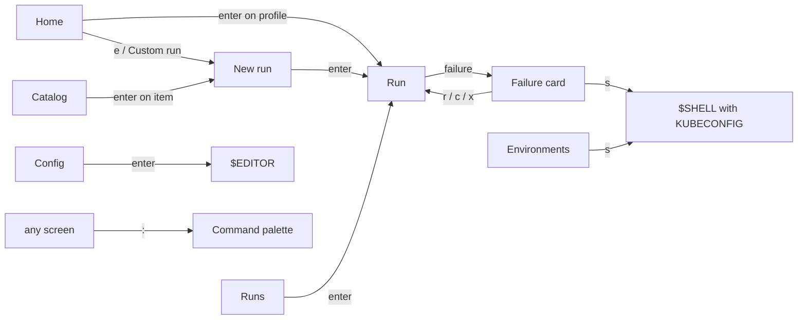

# wendy UI mockups: TUI

Wireframes for the terminal UI. The web UI ([web.html](./web.html)) has the same screens, wording, statuses and actions, so learning one means you know the other.

All screens are drawn at 108 columns. Below 100 columns, two-pane screens stack, and `tab` switches between the panes.

## UX principles

1. **One obvious next action.** Every screen highlights its main action. The footer always lists the keys that work on this screen, so you never have to memorise them.
2. **Start from something runnable.** Home opens on *profiles*: runs you can start with one key. On first launch, with no config at all, the built-in `quickstart` profile still works.
3. **Show the plan before running.** Before anything starts you see:
   - what will run
   - what it needs (VMs, RAM, disk, source builds)
   - roughly how long it will take, based on past runs
   - pre-flight checks

   That avoids surprises ten minutes in.
4. **Follow the action.** A live run tracks the running step automatically. If you navigate away, follow pauses, and `f` turns it back on.
5. **Failure first.** A failed run opens on a *failure card*:
   - the error in plain language
   - the related Tinkerbell cause (e.g. which workflow action failed)
   - evidence, one key away
   - what you can do next: shell, retry, continue or abort
6. **Product vs. harness.** `✗ failed` means Tinkerbell or CAPT misbehaved. `! errored` means wendy or the host broke. The two never share a glyph or colour.
7. **Files are the truth.** The UIs never edit your config. The Config tab shows errors with file:line and opens `$EDITOR`. Saving a file reloads it automatically.
8. **Safe by default.** Anything destructive uses a capital-letter key (`D` tear down/delete) and asks for confirmation. `q` asks first while runs are active.
9. **Same everywhere.**
   - Arrows or `j`/`k` move, `enter` opens or runs, `esc` goes back.
   - `1`–`5` switch tabs, `/` filters, `:` opens the command palette, `?` shows help.

## Status vocabulary

| Glyph | Meaning | Colour |
|---|---|---|
| `✓` | passed | green |
| `✗` | failed: an assertion about Tinkerbell/CAPT | red |
| `!` | errored: wendy, a container or the host broke | yellow |
| `●` | running | blue |
| `○` | waiting to run | grey |
| `‖` | paused on failure; environment kept | magenta |
| `–` | skipped / not run | grey |
| `⊘` | cancelled | grey |

Glyphs never rely on colour alone, so `NO_COLOR` and colour-blind users lose nothing.

## Navigation



---

## 1. First launch (no config)

This works with zero setup. The host check shows what's missing *before* you try anything. Pressing `i` writes one commented starter file. That is the only time the UI creates a file, and only if none exists.

```
┌──────────────────────────────────────────────────────────────────────────────────────────────────────────┐
│ ◆ wendy   [1 Home]   2 Runs    3 Catalog    4 Environments    5 Config                                  │
├──────────────────────────────────────────────────────────────────────────────────────────────────────────┤
│                                                                                                          │
│   Welcome to wendy.                                                                                     │
│                                                                                                          │
│   No config found yet. wendy looked in:                                                                 │
│     ~/.config/wendy/   ./.wendy/                                                                       │
│                                                                                                          │
│   You can still run the built-in profile right now:                                                      │
│                                                                                                          │
│   > quickstart     one small testbed · kind + libvirt · smoke suite     ≈ 15 min                         │
│                                                                                                          │
│   Or press  i  to create ./.wendy/wendy.cue with a commented starter config.                           │
│   wendy reloads it automatically as you edit it.                                                        │
│                                                                                                          │
│   Host check   ✓ docker   ✓ libvirt (qemu:///system)   ✓ /dev/kvm   ✗ git (only for source builds)       │
│                                                                                                          │
└──────────────────────────────────────────────────────────────────────────────────────────────────────────┘
 enter run quickstart  i create starter config  ? help  q quit
```

## 2. Home

- **Left:** what you can start. The selected profile expands into a summary card, so `enter` is never a blind action.
- **Right:** what's happening now, what happened recently, and what needs you.

```
┌──────────────────────────────────────────────────────────────────────────────────────────────────────────┐
│ ◆ wendy   [1 Home]   2 Runs    3 Catalog    4 Environments    5 Config         ● 1 running              │
├────────────────────────────────────────────────────┬─────────────────────────────────────────────────────┤
│ START A RUN                                        │ ACTIVE                                              │
│                                                    │ ● r-0412  my-branch    lifecycle › scale-out  22:14 │
│ > pr-check               1 combo · smoke    ✓ 14m  │           ███████████░░░░░░░░░  9/21                │
│   my-branch              1 combo · 2 suites ✗ 41m  │                                                     │
│   ci-matrix              8 combos · smoke   ! 1h52 │ RECENT                                              │
│   upgrade-from-release   1 combo · upgrades   —    │ ✓ r-0411  pr-check                  14m02   2h ago  │
│   ─────────────────────────────────────────────    │ ✗ r-0410  my-branch                 41m10   5h ago  │
│   + Custom run…                                    │ ! r-0409  ci-matrix   7✓ 1!         1h52    1d ago  │
│                                                    │ ✓ r-0408  pr-check                  13m51   1d ago  │
│ ┌ pr-check ──────────────────────────────────┐     │                                                     │
│ │ full › colocated-ipv4-netboot-direct       │     │ NEEDS ATTENTION                                     │
│ │ suites: smoke        keep env: never       │     │ ‖ r-0410  paused on failure · environment kept      │
│ │ last: ✓ 14m02 (r-0411)    typical: ~14m    │     │           → enter to inspect, s for a shell         │
│ │                                            │     │                                                     │
│ │      [ enter  Run ]    [ e  Edit & run ]   │     │                                                     │
│ └────────────────────────────────────────────┘     │ web UI: http://127.0.0.1:7600                       │
└────────────────────────────────────────────────────┴─────────────────────────────────────────────────────┘
 enter run  e edit & run  tab next pane  1-5 tabs  n new run  : commands  ? help  q quit
```

## 3. New run (Custom run, or Edit & run)

One form, no wizard. The plan on the right updates as you type. Edits are for this run only and never touch your files.

```
┌─ New run · based on pr-check ──────────────────────┬─────────────────────────────────────────────────────┐
│ WHAT                                               │ PLAN                                                │
│  Target    (•) Matrix     ( ) Environment          │  4 combinations × 2 suites                          │
│  Matrix    full                            ▾       │                                                     │
│  Combos    colocated-ipv4-*                ✎       │  colocated-ipv4-netboot-direct                      │
│            4 of 16 match                           │    smoke       deploy, 7 checks                     │
│  Suites    [x] smoke  [x] lifecycle                │    lifecycle   deploy › scale-out › upgrade-k8s ›   │
│            [ ] upgrades                            │                scale-in › delete                    │
│  Labels    (none)                          ✎       │  colocated-ipv4-isoboot-direct      (same)          │
│                                                    │  colocated-ipv4-netboot-mirror      (same)          │
│ HOW                                                │  colocated-ipv4-isoboot-mirror      (same)          │
│  Parallel          2                               │                                                     │
│  Keep environment  ( ) never                       │  Needs     6 VMs at once · 12 GiB RAM · 60 GiB disk │
│                    (•) on failure                  │  Builds    none (released artifacts)                │
│                    ( ) always                      │  Takes     ~1h10 (from 6 past runs)                 │
│  Pause on failure  [x]                             │  Checks    ✓ config  ✓ docker  ✓ kvm  ✓ disk space  │
│                                                    │                                                     │
├────────────────────────────────────────────────────┴─────────────────────────────────────────────────────┤
│                                            [ enter  Start run ]      [ esc  Cancel ]                     │
└──────────────────────────────────────────────────────────────────────────────────────────────────────────┘
 tab next field  space toggle  ←→ choose  ✎ type to edit  enter start  esc cancel
```

## 4. Run: live

- **Left:** a tree: Build → combination → Setup → suite → scenario → step.
- **Right:** the selected node, in human terms first (e.g. "replicas 1 → 2"), then its log.
- **Follow mode** keeps the running step selected.

```
┌─ Runs › r-0412 my-branch ────────────────────────────────────────────────────────────────────────────────┐
│ ● running   22:14   ███████████████░░░░░░░░░░░░░░  9/21 steps   ✓ 8  ✗ 0  ! 0      about 19 min left     │
├──────────────────────────────────────────┬───────────────────────────────────────────────────────────────┤
│ ✓ Build                            3m10  │ scale-out › wait for nodes                 2m49               │
│   ✓ tinkerbell  a1b2c3d (dirty)    3m02  │ MachineDeployment md-0   replicas 1 → 2                       │
│ ● colocated-ipv4-netboot-direct          │ ────────────────────────────────────────────────────────      │
│   ✓ Setup  (8 steps)               6m41  │ 22:11:02  scaling md-0 to 2 replicas                          │
│   ✓ smoke                          9m02  │ 22:11:04  hardware node-3 claimed (was spare)                 │
│   ● lifecycle                            │ 22:11:09  workflow node-3 started                             │
│     ✓ deploy  (reused)                   │ 22:11:30  workflow node-3  2/6 actions  ██░░░░                │
│ >   ● scale-out                    2m51  │ 22:12:58  workflow node-3  6/6 actions  ✓                     │
│         ✓ capt.scale               0m02  │ 22:13:40  node node-3 joined, waiting for Ready…              │
│         ● wait for nodes           2m49  │ ▌                                                             │
│     ○ upgrade-k8s                        │                                                               │
│     ○ scale-in                           │                                                               │
│     ○ delete                             │                                                               │
│                                          │ ────────────────────────────────────────────────────────      │
│                                          │ l full log   a artifacts   c console node-3                   │
│ ● follow  — tracking the running step    │ k kubeconfig   s shell with KUBECONFIG set                    │
└──────────────────────────────────────────┴───────────────────────────────────────────────────────────────┘
 ↑↓ select  →← expand/collapse  f follow  l log  a artifacts  c console  x cancel run  ? help
```

## 5. Run: failed and paused

The failure card is the first thing you see. It answers four questions in order:
1. What failed?
2. Why?
3. Where's the evidence?
4. What can I do now?

"Related" comes from the failure hook. It looks for failed Tinkerbell workflows and actions, so you don't have to dig for them.

```
┌─ Runs › r-0410 my-branch ────────────────────────────────────────────────────────────────────────────────┐
│ ‖ paused on failure   41:10   ██████████████████░░░░░░░░░░  14/21 steps   ✓ 13  ✗ 1  ! 0                 │
├──────────────────────────────────────────────────────────────────────────────────────────────────────────┤
│ ┌─ ✗ FAILED ───────────────────────────────────────────────────────────────────────────────────────────┐ │
│ │ Failed after 14m59:  lifecycle › upgrade-k8s › wait for rollout                                      │ │
│ │                                                                                                      │ │
│ │ Timed out waiting for MachineDeployment md-0: 1 of 2 machines updated.                               │ │
│ │ Related:  workflow node-3 failed at action "stream-image" (exit 1)                                   │ │
│ │                                                                                                      │ │
│ │ Evidence   [w] workflow   [c] console node-3   [b] BMC log   [d] cluster dump                        │ │
│ └──────────────────────────────────────────────────────────────────────────────────────────────────────┘ │
│                                                                                                          │
│   The environment is kept so you can look around.                                                        │
│   kubeconfigs  ~/.local/state/wendy/runs/r-0410/colocated-ipv4-netboot-direct/kubeconfigs/              │
│                                                                                                          │
│   [ s  Open shell here ]   [ r  Retry step ]   [ c  Continue ]   [ x  Abort and tear down ]              │
│                                                                                                          │
├──────────────────────────────────────────┬───────────────────────────────────────────────────────────────┤
│ ✓ Setup  (8 steps)                 6m41  │ upgrade-k8s › wait for rollout   (log, last 6 lines)          │
│ ✓ smoke                            9m02  │ 22:58:01  md-0 1/2 machines updated                           │
│ ✗ lifecycle                              │ 22:58:31  workflow node-3 action stream-image: exit 1         │
│   ✓ deploy  (reused)                     │ 22:58:31  workflow node-3 FAILED                              │
│   ✓ scale-out                      4m12  │ 23:06:02  md-0 1/2 machines updated                           │
│ > ✗ upgrade-k8s                   14m59  │ 23:12:44  timed out after 15m0s                               │
│   – scale-in      (not run)              │ l full log                                                    │
│   – delete        (not run)              │                                                               │
└──────────────────────────────────────────┴───────────────────────────────────────────────────────────────┘
 s shell  r retry step  c continue  x abort  w/c/b/d evidence  ↑↓ select  ? help
```

- **Open shell** suspends the TUI and starts `$SHELL` in the run directory, with `KUBECONFIG` set to the management cluster and `KUBECONFIG_WORKLOAD` / `KUBECONFIG_TINKERBELL` set as well. Exiting the shell returns to this screen.
- **Retry step** re-runs only the failed step against the kept environment. This is the fastest loop when you're fixing a timeout or a flaky wait.
- **Continue** records the failure and runs the remaining scenarios. **Abort** tears down and finishes the run.

## 6. Run: many combinations (grid view)

Multi-combination runs open in a grid, with one row per combination. `t` switches to the tree view from screen 4.

```
┌─ Runs › r-0409 ci-matrix ────────────────────────────────────────────────────────────────────────────────┐
│ ! errored   1h52   8 combos   ✓ 7  ✗ 0  ! 1           view: [g grid]  t tree                             │
├──────────────────────────────────────────────────────────────────────────────────────────────────────────┤
│                                                                                                          │
│                                     Build   Setup   smoke    time                                        │
│   colocated-ipv4-netboot-direct       ✓       ✓       ✓     13m51                                        │
│   colocated-ipv4-isoboot-direct       ✓       ✓       ✓     15m02                                        │
│   colocated-ipv6-netboot-direct       ✓       ✓       ✓     16m40                                        │
│ > colocated-ipv6-isoboot-direct       ✓       !       –      4m12   BMC container did not start          │
│   external-ipv4-netboot-direct        ✓       ✓       ✓     18m09                                        │
│   external-ipv4-isoboot-direct        ✓       ✓       ✓     19m33                                        │
│   external-ipv6-netboot-direct        ✓       ✓       ✓     20m01                                        │
│   external-ipv6-isoboot-direct        ✓       ✓       ✓     21m17                                        │
│                                                                                                          │
│   ! errored = wendy or the host failed, not Tinkerbell/CAPT. Re-running usually helps.                  │
│                                                                                                          │
└──────────────────────────────────────────────────────────────────────────────────────────────────────────┘
 enter open combo  R re-run failed combos  g grid  t tree  a artifacts  ? help
```

## 7. Runs

```
┌──────────────────────────────────────────────────────────────────────────────────────────────────────────┐
│ ◆ wendy    1 Home   [2 Runs]   3 Catalog    4 Environments    5 Config                                  │
│ / filter: my-branch        status: [all] running failed errored passed        sort: newest               │
├──────────────────────────────────────────────────────────────────────────────────────────────────────────┤
│      ID      PROFILE / SELECTION         RESULT              STARTED       TOOK    ENV                   │
│  >   r-0412  my-branch                   ● 9/21 running      22:00 today   22:14   —                     │
│      r-0410  my-branch                   ✗ failed ‖ paused   18:01 today   41:10   kept                  │
│      r-0402  my-branch                   ✓ passed            yesterday     38:57   —                     │
│      r-0395  my-branch  (edited)         ✓ passed            2 days ago    39:40   —                     │
│                                                                                                          │
└──────────────────────────────────────────────────────────────────────────────────────────────────────────┘
 enter open  R re-run  x cancel  D delete run (asks first)  / filter  ? help
```

## 8. Catalog

Everything your files define, plus the built-ins, with where each item comes from. `enter` on any item opens **New run** pre-filled with it, so browsing turns straight into running.

```
┌──────────────────────────────────────────────────────────────────────────────────────────────────────────┐
│ ◆ wendy    1 Home    2 Runs   [3 Catalog]   4 Environments    5 Config                                  │
│ Profiles   Environments   Matrices   Suites  [Scenarios]  Steps          / filter: scale                 │
├────────────────────────────────┬─────────────────────────────────────────────────────────────────────────┤
│ built-in                       │ scale-out                                 built-in                      │
│ > scale-out                    │ Adds one worker by claiming a spare machine and waits                   │
│   scale-in                     │ until it is a Ready node.                                               │
│ ./.wendy/acme.cue             │                                                                         │
│   acme-smoke                   │ Steps      1 capt.scale      machineDeployment +1                       │
│                                │            2 wait for nodes  timeout 20m                                │
│                                │            3 assert.healthy                                             │
│                                │ Needs      1 spare machine                                              │
│                                │ Labels     scale                                                        │
│                                │ Used by    suites: lifecycle                                            │
│                                │                                                                         │
│                                │ [ enter  Run this scenario… ]   [ v  View CUE source ]                  │
└────────────────────────────────┴─────────────────────────────────────────────────────────────────────────┘
 ↑↓ select  ←→ tabs  / filter  enter run…  v view source  ? help
```

## 9. Environments

Kept and paused environments, with everything needed to connect to them.

```
┌──────────────────────────────────────────────────────────────────────────────────────────────────────────┐
│ ◆ wendy    1 Home    2 Runs    3 Catalog   [4 Environments]   5 Config                                  │
├────────────────────────────────────────────┬─────────────────────────────────────────────────────────────┤
│ > ‖ r-0410 colocated-ipv4-netboot-direct   │ r-0410 · colocated-ipv4-netboot-direct                      │
│     paused · since 23:12 · my-branch       │                                                             │
│   ✓ r-0397 external-ipv6-netboot-direct    │ Clusters   management  kind capt-r0410                      │
│     kept · 2d old · up for 2d 4h           │            workload    wendy     (2 nodes)                  │
│                                            │ Tinkerbell 172.18.0.100   chart v0.25.1-a1b2c3d             │
│                                            │ Machines   node-1  cp      172.18.0.11  ✓ Ready             │
│                                            │            node-2  worker  172.18.0.12  ✓ Ready             │
│                                            │            node-3  worker  172.18.0.13  ✗ workflow failed   │
│                                            │ BMC        redfish  https://172.18.0.2:443/…/node-*         │
│                                            │                                                             │
│                                            │ [ s Shell ]  [ k Copy KUBECONFIG export ]  [ D Tear down ]  │
└────────────────────────────────────────────┴─────────────────────────────────────────────────────────────┘
 ↑↓ select  s shell  k copy kubeconfig  c console  D tear down (asks first)  ? help
```

## 10. Config

Errors read like a compiler's: file:line, the path inside the config, and a suggestion when one is obvious. A bad file never takes down the rest.

```
┌──────────────────────────────────────────────────────────────────────────────────────────────────────────┐
│ ◆ wendy    1 Home    2 Runs    3 Catalog    4 Environments   [5 Config]   !2                            │
├──────────────────────────────────────────────────────────────────────────────────────────────────────────┤
│ Watching  ~/.config/wendy/  ./.wendy/              last reload 23:20:14 (2 errors)                     │
│                                                                                                          │
│ ✓ ./.wendy/environments.cue                                                                             │
│ ✗ ./.wendy/acme.cue                                                                                     │
│     41:12  scenarios."acme-smoke".steps.0.timeout: "15 min" is not a duration (e.g. "15m")               │
│     58:3   profiles.nightly.suites.1: unknown suite "lifecylce" (did you mean "lifecycle"?)              │
│ ✓ ./.wendy/profiles.cue                                                                                 │
│                                                                                                          │
│ The last valid config is still in use, so everything else keeps working.                                 │
│ Fix the file and save. wendy reloads it automatically.                                                  │
│                                                                                                          │
└──────────────────────────────────────────────────────────────────────────────────────────────────────────┘
 ↑↓ select  enter open file in $EDITOR  r reload now  ? help
```

## 11. Command palette (`:`)

This is a fuzzy search over actions, profiles, runs and environments, for people who'd rather type than navigate. `?` opens the full key list for the current screen.

```
┌──────────────────────────────────────────────────────────────────────────────────────────────────────────┐
│ ◆ wendy   [1 Home]   2 Runs    3 Catalog    4 Environments    5 Config                                  │
│                                                                                                          │
│                     ┌─ : command ──────────────────────────────────────────────┐                         │
│                     │ :ru▌                                                     │                         │
│                     │ ───────────────────────────────────────────────────────  │                         │
│                     │ > run pr-check            start a profile                │                         │
│                     │   run my-branch           start a profile                │                         │
│                     │   rerun r-0410            re-run with the same selection │                         │
│                     │   runs                    go to Runs                     │                         │
│                     │                                                          │                         │
│                     │ Everywhere:  ? help   : commands   / filter   1-5 tabs   │                         │
│                     │              esc back   q quit (asks if runs are active) │                         │
│                     └──────────────────────────────────────────────────────────┘                         │
│                                                                                                          │
└──────────────────────────────────────────────────────────────────────────────────────────────────────────┘
 type to search · enter run · esc close
```

## 12. `--plain` (CI and non-TTY)

Same vocabulary, one line per event, no cursor movement. It is safe for CI logs and `grep`.

```
wendy run --profile ci-matrix --plain
r-0409  plan  8 combos × smoke · parallel 2 · ~1h50
r-0409  ✓ build                                                    0m00  (released artifacts)
r-0409  ● colocated-ipv4-netboot-direct  setup
r-0409  ✓ colocated-ipv4-netboot-direct  setup                     6m02
r-0409  ✓ colocated-ipv4-netboot-direct  smoke › deploy            5m40
r-0409  ! colocated-ipv6-isoboot-direct  setup › env.bmc           0m31  BMC container did not start: port 8443 in use
...
r-0409  ! errored  7 passed · 0 failed · 1 errored · 1h52
r-0409  report  ~/.local/state/wendy/runs/r-0409/report.junit.xml
```
